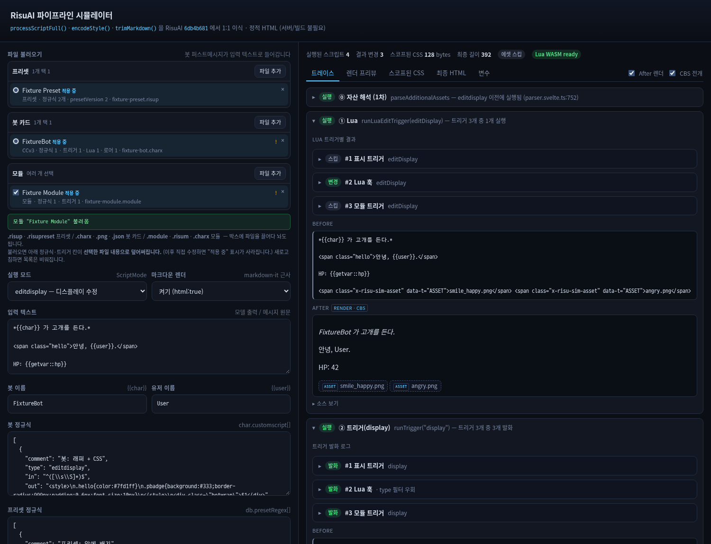
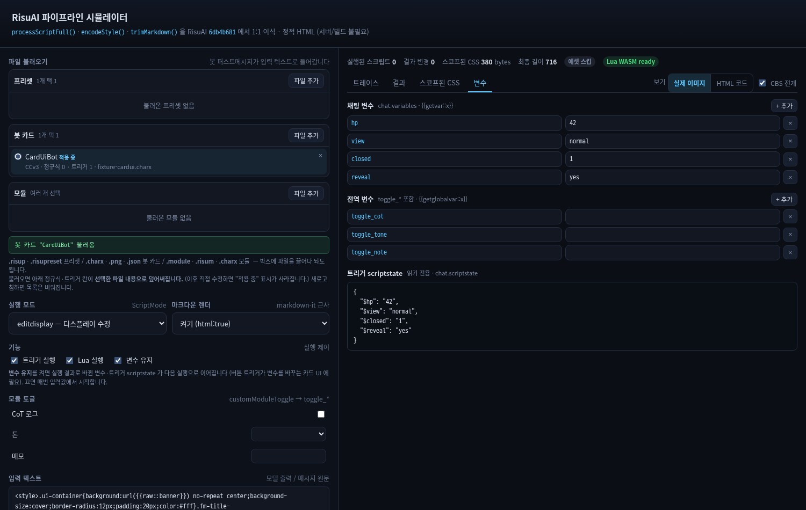
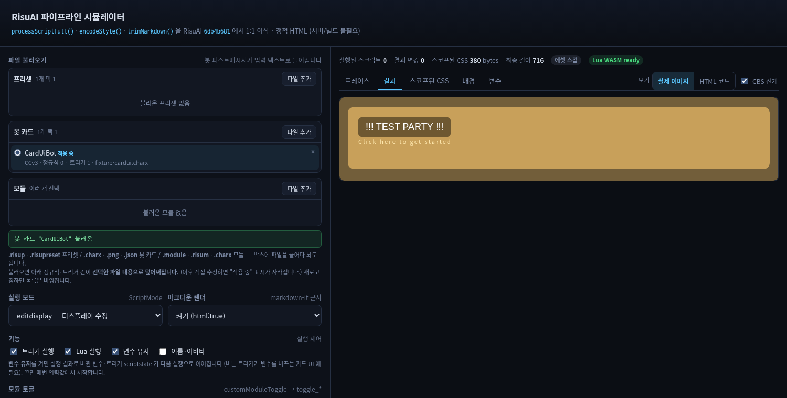
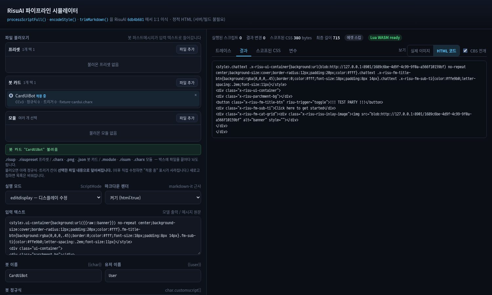
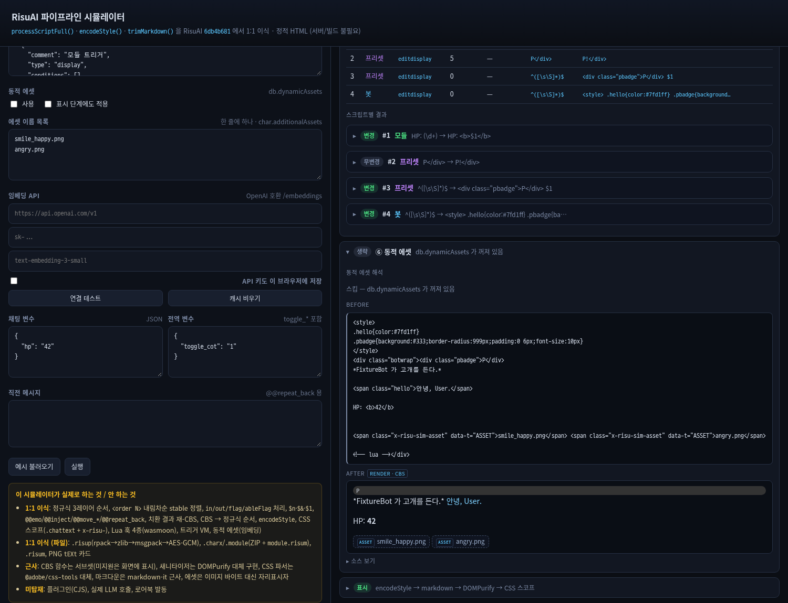
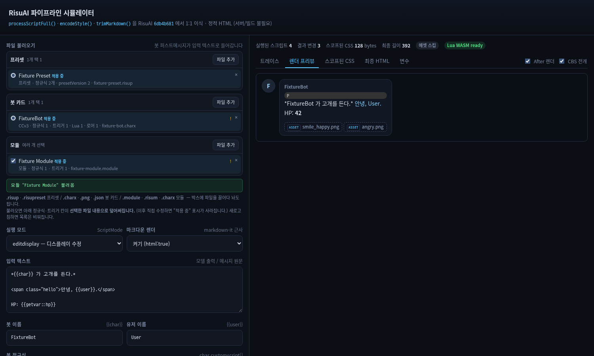
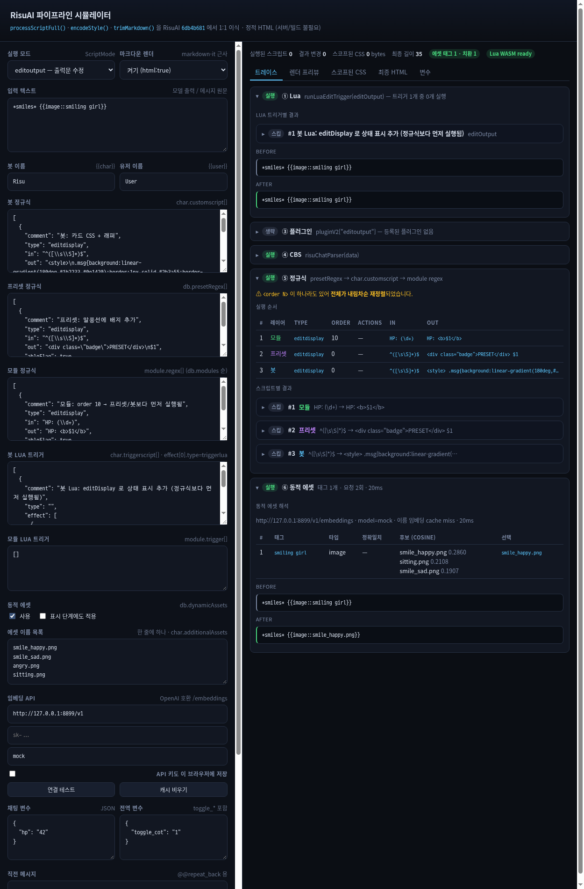

# RisuAI Pipeline Simulator

RisuAI 의 **메시지 처리 파이프라인**을 코드 레벨로 분석하고, 그 동작을 **정적 웹페이지에서 재현**하는 프로젝트입니다.

### ▶ [`https://ihabis02.github.io/risuai-pipeline-simulator/`](https://ihabis02.github.io/risuai-pipeline-simulator/)

빌드 없이 바로 실행되는 라이브 데모입니다.

- 정규식 스크립트(프리셋 / 봇 / 모듈)의 **실행 순서와 `<order N>` 정렬**
- CBS `{{...}}` 전개, HTML/CSS 스코프(`.chattext` + `x-risu-`), DOMPurify 살균
- **Lua** 편집 훅 (`listenEdit`) — wasmoon(Lua 5.4 WASM)
- **트리거** VM — 조건 평가, indent 인터프리터, display/request allowlist
- **동적 에셋** — OpenAI 호환 `/embeddings` 로 에셋 이름 유사도 매칭
- **파일 불러오기** — `.risup` 프리셋 / `.charx` 봇 카드 / `.module` 모듈을 그대로 읽어서 적용
- **트리거 · 변수 · 토글** — `risu-trigger` 버튼 실행, 변수 편집기, `customModuleToggle` 스위치
- **카드 배경** — `backgroundHTML` / `module.backgroundEmbedding` 을 메시지 뒤 레이어로
- **보기 모드 2종** — 결과를 **실제 이미지**(카드 CSS·에셋 적용) 또는 **HTML 코드**(최종 소스)로
- **After 렌더** — 트레이스의 각 단계 결과도 같은 보기 모드로 표시

빌드도, 서버도, 패키지 설치도 필요 없습니다. `risu-sim/index.html` 을 열면 바로 동작합니다.

> ⚠️ 이 저장소는 **분석/디버깅 도구**입니다. 앱이 아니고, LLM과 대화하지 않습니다.

---

## 구성

```
.
├── RisuAI-pipeline-analysis.md   # 분석 문서 (1,200줄) — 10장 + 부록
├── risu-sim/                     # 실행 가능한 시뮬레이터 (정적 HTML)
│   ├── index.html                # UI
│   ├── simulator.js              # 정규식 · CBS · CSS 스코프 · 새니타이저 · 표시 렌더
│   ├── importer.js               # 파일 로더 (.risup · .charx · .module · .risum · .png)
│   ├── lua-runtime.js            # Lua (wasmoon)
│   ├── trigger-runtime.js        # 트리거 VM
│   ├── asset-runtime.js          # 동적 에셋 (OpenAI 호환 임베딩)
│   ├── test.js                   # 단위 테스트 129개
│   ├── tools/                    # 픽스처 생성기 · 브라우저 UI 테스트 · 목 임베딩 서버
│   └── vendor/                   # wasmoon, json.lua (오프라인 동작용)
├── LICENSE                       # GPL-3.0
└── NOTICE.md                     # 출처 · 제3자 라이선스
```

## 빠른 시작

가장 빠른 방법은 위 라이브 데모를 여는 것입니다. 로컬에서 돌리려면:

```bash
git clone https://github.com/IHaBiS02/risuai-pipeline-simulator.git
cd risuai-pipeline-simulator/risu-sim

# 방법 1: 그냥 열기
xdg-open index.html

# 방법 2: 정적 서버 (Lua · 임베딩 API 사용 시 권장)
python3 -m http.server 8080
# → http://localhost:8080
```

### 테스트

```bash
cd risu-sim && node test.js
# → 129 passed, 0 failed

# 브라우저 UI 통합 테스트 (파일 주입 + 클릭 104개 항목)
python3 -m http.server 8901 &
chromium --headless=new --no-sandbox --virtual-time-budget=60000 \
  --dump-dom "http://127.0.0.1:8901/tools/ui-test.html"
```

### 동적 에셋을 API 키 없이 테스트

```bash
python3 tools/mock-embeddings.py 8899
```

```
http://localhost:8080/?asset=1&assetUrl=http://127.0.0.1:8899/v1&assetModel=mock&mode=editoutput
```

실제 API를 쓰려면 설정 패널의 **임베딩 API** 에 URL(`https://api.openai.com/v1`), 키, 모델명(`text-embedding-3-small`)을 넣으면 됩니다.

---

## 화면

**파일 불러오기** — `.risup` / `.charx` / `.module` 을 끌어다 놓으면 프리셋·봇·모듈 칸이 채워집니다



**모듈 토글 + 변수 편집기** — 카드의 `customModuleToggle` 이 스위치로, 변수는 직접 편집



**HTML 카드 UI 봇** — `{{#when}}` 중첩 조건 + charx 안의 이미지로 실제 화면과 같게



같은 결과를 **HTML 코드** 모드로 보면 최종 HTML 소스가 나옵니다 (보기 스위치로 전환)



**After 렌더** — 각 단계의 결과를 자산·카드 CSS 까지 적용해 채팅처럼



**트레이스** — 단계별 before/after 와 트리거 발화 로그


**채팅 프리뷰** — 봇 퍼스트메시지를 말풍선으로, 실제 `.chattext` 스코프가 적용된 결과



**동적 에셋** — 태그 → 후보(코사인) → 선택



---

## 구현 범위

| 레이어 | 상태 | 비고 |
|---|---|---|
| 정규식 3레이어 + `<order N>` | ✅ 1:1 | `scripts.ts` |
| CBS `{{...}}` | 🟡 서브셋 | 미지원 태그는 화면에 표시 |
| HTML/CSS 스코프 · 새니타이저 | 🟡 근사 | DOMPurify 대체 구현 |
| Lua `listenEdit` 4종 | ✅ 1:1 | wasmoon, 동일 엔진 |
| 트리거 VM + 35 effect | ✅ 1:1 | allowlist · 재귀 · indent |
| 동적 에셋 | ✅ 1:1 | OpenAI 호환 `/embeddings` |
| 파일 불러오기 (.risup/.charx/.module/.risum/.png) | ✅ 1:1 | `importer.js` |
| 버튼 트리거 (`runTrigger('manual')`) | ✅ 1:1 | `Chat.svelte:305` |
| 채팅 변수 = `scriptstate['$key']` 통일 | ✅ 1:1 | `chatVar.svelte.ts:6` |
| 모듈 토글 (`customModuleToggle`) | ✅ 1:1 | `util.ts:1049` |
| After 렌더 (자산·카드 CSS) | ✅ 추가 기능 | `renderDisplay()` |
| 플러그인 (CJS) | ⬜ 미탑재 | 설계만 |
| 플러그인 | ⬜ 미탑재 | 훅 6개 구현 예정 |
| 실제 LLM 호출 | ❌ 범위 밖 | |

자세한 차이는 [risu-sim/README.md](risu-sim/README.md) 와
[risu-sim/ADDING-RUNTIMES.md](risu-sim/ADDING-RUNTIMES.md) 를 참고하세요.

---

## 분석 문서

[RisuAI-pipeline-analysis.md](RisuAI-pipeline-analysis.md) 에 정리되어 있습니다.

1. 네 레이어(봇/모듈/플러그인/프롬)의 관계
2. 단일 관문 `processScriptFull()` 구조
3. 다섯 개 실행 지점과 전체 타임라인
4. 레이어별 상세 (정규식 · HTML · CSS · Lua)
5. 순서 결정 규칙 총정리
6. 함정 22개 체크리스트
7. RisuAI vs PocketRisu 차이

---

## 라이선스

**GNU GPL v3.0** — [LICENSE](LICENSE)

이 프로젝트는 [RisuAI](https://github.com/kwaroran/Risuai) (GPL-3.0, © 2024 Kwaroran) 의
소스를 분석·이식한 2차적 저작물이므로 동일한 라이선스를 따릅니다.
출처와 제3자 라이선스는 [NOTICE.md](NOTICE.md) 를 참고하세요.
